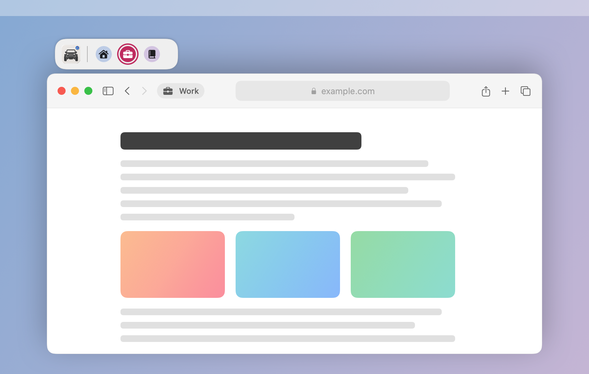
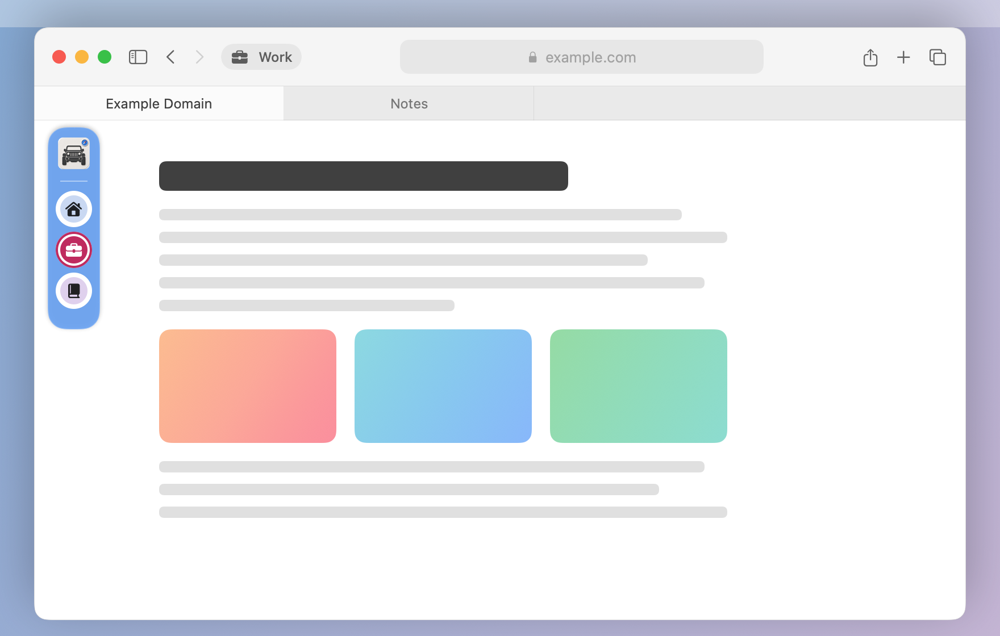

# Jeep

A macOS menu-bar app that makes Safari profiles feel like one window.

Jeep keeps exactly one Safari profile window on-screen. The other profile windows stay open but hidden — not minimized, and out of Mission Control — so their tabs, cookies, and extensions are untouched. A small floating profile bar attaches to the visible window; click a profile to swap it into the same position and size.



When there is room, the bar sits just above Safari.



When there isn't, it becomes a rail over the page, shown here opened on hover.

*Jeep's own bar, rendered with sample profiles; the Safari window is illustrative.*

## Install

1. Open `Jeep-<version>.dmg` from Releases and drag **Jeep** onto **Applications**.
2. Launch Jeep from `/Applications`.

Release disk images are notarized by Apple and open normally. A copy you build yourself is not: macOS blocks its first open, and you allow it in **System Settings → Privacy & Security → Open Anyway** (on macOS 14 you can also right-click Jeep › **Open**).

Requirements: macOS 14 or later, and Safari with two or more [profiles](https://support.apple.com/guide/safari/profiles-ibrd4ad1a3a8/mac), one window each.

## Using Jeep

- The first launch opens a short welcome. Nothing is hidden until you click **Start Jeep**.
- Click a profile in the floating bar, or in Jeep's menu-bar menu (⌘1–⌘9), to switch.
- New Safari windows are folded into single-window mode; closing the visible window brings another profile forward. By design, Jeep skips Safari's own Settings window and other windows that Safari reports have no web page; this has not been checked by hand against Safari.
- The bar keeps the selected or incoming profile in view when its icons overflow. A slow close handoff retains the same bar until a replacement is confirmed; a missing sample or elapsed time alone cannot dismiss it.
- When there is no room above Safari, the bar sits over the page as a small blue Jeep. Hover it and the rail springs open with the profiles; it folds back as soon as the pointer leaves. With VoiceOver, use the Jeep's **Show Profiles** action.
- Right-click a profile in the bar and choose **Close Window** to close that profile's Safari window and its tabs without switching to it. If it was the visible one, the next profile takes its place.
- **Settings…** (menu-bar menu, ⌘,) sets profile labels, open at login, permissions, and what happens when the chosen profile's window is on another Space.
- Opening Jeep again while it is running opens Settings.

### Several Jeep windows

One Jeep window is one visible Safari window plus its hidden profiles and its own bar. You can have several, for example one per display:

- Right-click a profile in a bar and choose **Move to New Jeep Window**. That profile's window appears slightly below and to the right of its old place, with its own bar; drag it wherever you want. If it was the visible profile, the next profile takes its place.
- Right-click the Jeep logo in a bar and choose **Merge Into** → another Jeep window. The profile this bar was showing moves into the other window's place, and the other window's profile is hidden. All profiles then share one bar.
- Clicking a profile switches only inside its own Jeep window. A new Safari window joins the Jeep window you used last.
- The menu-bar menu lists each Jeep window's profiles in its own section.
- Jeep remembers its windows when it quits and reopens while Safari keeps running. After Safari restarts, all profiles start in one Jeep window again.

Profile names come from Safari's native Accessibility controls, never page-title prefixes. Verified names are cached for that window and Safari process lifetime, so Jeep-hidden windows keep their labels. When no native name is available, a numbered button and a `Safari window <id>` label keep the window selectable; custom profile labels stay unavailable until its native name is known.

Very old, window-ID-based labels remain untouched in preferences, but are not automatically assigned to profiles: window IDs can be reused. Re-enter any desired labels in Settings once the native profile names appear.

## Permissions

| Permission | Why | When it's asked | If you say no |
|---|---|---|---|
| Automation → Safari (required) | Hides, positions, and reveals individual Safari windows with Apple Events | The first time Jeep reads Safari's windows, right after you click **Start Jeep** | Jeep cannot manage windows. The menu shows "Safari access needed" with **Allow Safari Control…** |
| Accessibility (optional) | Reads native profile names, places the bar precisely under Safari's toolbar and any tab or favorites bar, and notices closed windows sooner | Only when you click **Grant…** in the welcome or in Settings | Switching still works with numbered windows; names not previously verified are unavailable, bar placement uses window frames, and close detection is slower |

Also:

- **Login item:** a new install offers **Open Jeep at login** already checked in the welcome; it is registered only when you click **Start Jeep**, and you can uncheck it there or turn it off later in Settings. Only offered when Jeep is in an Applications folder. Updating keeps your existing choice.
- **Network:** none. Jeep has no network code and listens on no ports.
- **Screen Recording:** not requested. Jeep reads Safari's window positions from the window server, never window contents or titles from it.
- **Private API:** native profile-name lookup uses optional `_AXUIElementGetWindow` to associate Safari's Accessibility controls with an exact window id. Unavailable lookup leaves the window unidentified rather than guessing. The optional **Bring the window to the current Space** setting uses private window-server functions (`CGSMoveWindowsToManagedSpace`); it is off by default and falls back to switching Spaces when unavailable. When a profile you choose is on another Space, Jeep switches you there by focusing its window through private window-server functions (`CGSCopySpacesForWindows`, `CGSCopyManagedDisplaySpaces`, `_SLPSSetFrontProcessWithOptions`, `SLPSPostEventRecordTo`); without them the window is shown on its own Space and you stay where you are.
- **Files written:** `~/Library/Logs/Jeep/journal.jsonl` (and `journal.previous.jsonl`), plus Jeep's preferences (`com.yeshaya.Jeep`).

Builds that are not signed with a Developer ID lose the Automation and Accessibility grants when the app is updated. Remove Jeep from each list and add it again, or reset them:

```sh
tccutil reset AppleEvents com.yeshaya.Jeep
tccutil reset Accessibility com.yeshaya.Jeep
```

## Your data

- **Preferences** (`com.yeshaya.Jeep`): your settings, the profile labels you type, the last active window id, and the hidden-window record (Safari window ids and frames, written before every hide so a crash can be repaired). A native-name cache stores verified Safari profile names and window ids with Safari's process id and launch date; names are not reused across Safari lifetimes. With several Jeep windows, which window ids belong together (and each one's position) is stored with Safari's process id and launch date, and dropped when Safari restarts. No page titles or URLs.
- **Journal** (`~/Library/Logs/Jeep/journal.jsonl`): a local diagnostic log of window events, capped at 8 MB with one previous file kept. New entries hold window ids, visibility, frames, and error messages. Window titles are blanked and native profile names are removed before writing; URLs are never read. Older builds may have stored titles or title prefixes, and upgrading does not erase existing logs. **Settings → Troubleshooting → Activity log** shows them in Finder.
- Nothing leaves your Mac.

## Uninstall / recovery

Quitting Jeep attempts to reveal every Safari window. **Pause Jeep** does the same without quitting. **Resume Jeep** re-hides the others when the remembered window is already visible, without moving it or activating Safari. If that window is hidden, select a profile explicitly to show it.

Jeep records which windows it may hide before hiding them, so that after a crash or force-quit its next launch can reveal them. If that record cannot be saved (for example, the disk is full), Jeep hides nothing and says so. Partial inventories retain unresolved records. The record is cleared after Safari quits or three consecutive close-confirmation inventories are empty, each re-checking the recorded ids; WindowServer emptiness alone is not enough. Recovery is still best effort: if a reveal fails, Jeep keeps the record and reports the error. **Show All Safari Windows (Emergency)** bypasses ordinary switching state, cancels queued switches, reveals the recorded windows in place, and leaves Jeep paused.

**Without Jeep** (for example, it was deleted while windows were hidden), reveal every Safari window from Terminal. macOS asks once whether Terminal may control Safari:

```sh
osascript -e 'tell application "Safari" to set visible of every window to true'
```

To remove Jeep completely:

1. Quit Jeep (reveals all Safari windows).
2. Turn off **Open at login** in Settings, or remove Jeep from **System Settings → General → Login Items**.
3. Delete `Jeep.app` from Applications.
4. Remove its data:

```sh
rm -rf ~/Library/Logs/Jeep
defaults delete com.yeshaya.Jeep
```

## Build from source

Requires Xcode command-line tools with Swift 6.

```sh
swift test                  # run the test suite
sh Scripts/build_app.sh     # universal app at .build/Jeep.app
sh Scripts/package_dmg.sh   # disk image at Release/Jeep-<version>.dmg
```

If `.build` does not exist yet, `build_app.sh` links it to `~/Library/Caches/Jeep-build` so build output stays out of the source folder.

Extend or override icon keywords locally with git-ignored `Support/IconKeywords.local.json` (a keyword-to-SF-Symbol object, e.g. `{"garden":"leaf.fill"}`), then rebuild; local matches win and the file is included in your app bundle, not public source exports.

Builds are ad-hoc signed by default. To sign and notarize, set:

- `JEEP_SIGN_IDENTITY` — a "Developer ID Application" signing identity (or put it on the first line of a `.signing-identity` file in the project root; git ignores it)
- `JEEP_NOTARY_PROFILE` — a keychain profile created with `xcrun notarytool store-credentials`

With both set, `package_dmg.sh` notarizes and staples the disk image. Public releases use `Scripts/package.sh`, which refuses to build without both.

## License

[MIT](LICENSE)
